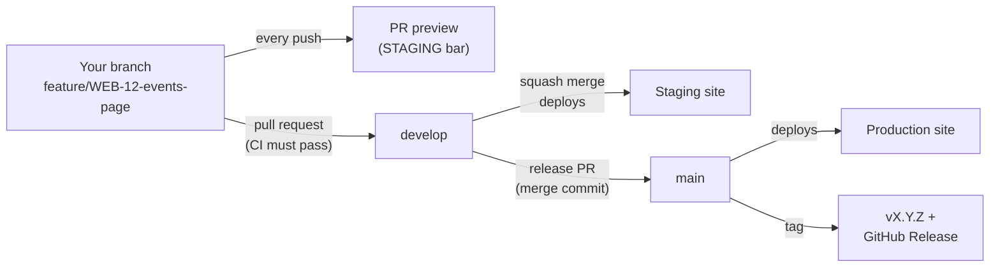

# Contributing

How work gets done on the FCCY National Website, from picking up a ticket to shipping it. Follow these steps and you shouldn't need to ask anyone how things work.

## The big picture



| Tool | Its job |
|---|---|
| **Jira** (project `WEB`) | Tracks what to work on. Every branch, commit, and PR names its ticket key. |
| **GitHub** | Stores the code, hosts pull requests, and enforces the branch rules. |
| **GitHub Actions** | Runs CI on every PR: type-check, tests, build. It never deploys. |
| **Cloudflare Workers Builds** | Builds and deploys the site: previews, staging, and production. |

## Branches

| Branch | What it is | Deploys to |
|---|---|---|
| `main` | Production. Only changes through a release or a hotfix. | https://fccynational-site.fccy.workers.dev |
| `develop` | Staging. Every finished ticket lands here first. | https://fccynational-site-staging.fccy.workers.dev |
| anything else | Your work in progress. | A preview link, posted on its PR |

Nobody can push directly to `main` or `develop`, including the repo owner. GitHub rejects it. All changes go through a pull request.

### Naming your branch

Branch from `develop` and include the Jira key:

```
<type>/WEB-<number>-<short-description>
```

| Prefix | Use for | Example |
|---|---|---|
| `feature/` | New pages or functionality | `feature/WEB-12-events-page` |
| `fix/` | Bug fixes going through the normal flow | `fix/WEB-20-broken-date-format` |
| `docs/` | Documentation only | `docs/WEB-15-contributing-guide` |
| `chore/` | Tooling, config, dependencies | `chore/WEB-18-update-astro` |
| `hotfix/` | Urgent production fixes (branch from `main`, see [Hotfixes](#hotfixes)) | `hotfix/WEB-30-signup-crash` |

Copy the key from the Jira ticket itself; don't type it from memory.

## Commit messages

Use [Conventional Commits](https://www.conventionalcommits.org/) and end with the ticket key:

```
<type>: <what changed, in present tense> (WEB-<number>)
```

```
feat: add events page (WEB-12)
fix: show event dates in Philippine time (WEB-20)
docs: add rollback steps to README (WEB-11)
```

Types: `feat`, `fix`, `docs`, `chore`, `ci`, `test`, `refactor`.

Commits are authored by people only. Don't add `Co-authored-by` lines for bots or AI tools. [.claude/settings.json](.claude/settings.json) already turns this off for Claude Code.

## Doing the work

### First-time setup

1. Install Node.js. The version is in [`.node-version`](.node-version).
2. Clone the repo, then run `npm install`.
3. `npm run dev` → http://localhost:4321. The orange **DEVELOPMENT** bar means you're looking at your local copy.

### Day to day

```powershell
git switch develop
git pull --prune                                # get the latest develop, forget deleted branches
git switch -c feature/WEB-12-events-page        # new branch from develop
# ...make changes...
npm run check; npm test; npm run build          # the same checks CI will run
git add <files>
git commit -m "feat: add events page (WEB-12)"
git push -u origin feature/WEB-12-events-page   # first push; later just `git push`
```

> **Windows (PowerShell 5.1):** use `;` between commands, not `&&`. `&&` is a syntax error in Windows PowerShell.

## Pull requests

Open the PR with **base: `develop`**. Check the base branch every time, because a wrong base is how unreviewed changes reach production.

**The PR title becomes the commit message on `develop`**, so write it in the same format as a commit: `feat: add events page (WEB-12)`. The PR template asks for the ticket, a summary, and a checklist. Fill it in.

### Before you merge

- [ ] **CI / Check, test, build** is green. GitHub won't let you merge until it is.
- [ ] You opened the **preview link** and checked the change in a browser (see below).
- [ ] The **Commits** tab only lists commits authored by people.
- [ ] No secrets (API keys, passwords) in the diff. This repo is public.
- [ ] If the change touches personal data, it follows the privacy rules in the PR template (Philippine Data Privacy Act).

Then click **Squash and merge**. GitHub combines all your commits into one commit on `develop` and deletes the branch. Afterwards:

```powershell
git switch develop
git pull --prune
git branch -D feature/WEB-12-events-page   # -D because git can't tell a squashed branch was merged
```

Within about a minute the staging site updates. Then move the Jira ticket to **Done**.

### Using the preview link

Every push to a branch makes Cloudflare build a **preview** of it. You'll find the link in a Cloudflare comment on the PR, or under **Details** on the **Workers Builds: fccynational-site-staging** check.

- The page has the orange **STAGING** bar. That's expected: previews are never the live site.
- Click through the pages you changed, and check them on your phone's screen size too.
- Each new push updates the same preview.
- **Preview links are public.** Anyone with the link can open them, so don't put anything private on a branch.

A red **Workers Builds** check doesn't block merging. Only CI is required. If it fails, read the build log in Cloudflare before merging.

## Adding or updating content

> **To be completed in roadmap item 5 (pages).** The events and chapters content collections don't exist yet. When they're built, this section will list the folder for each, an example file, and every required field.

What's already decided:

- Events and chapters are **Markdown files** in the repo, one file per event or chapter.
- Content changes follow the same flow as code: branch (`docs/` or `feature/`), PR, check the preview link, squash and merge.
- A mistake in a content file (a missing date, a typo in a field name) makes **CI fail**, so broken content can't reach the site.

## Releases

A release ships everything on `develop` to production.

**Versions** follow [semantic versioning](https://semver.org/): `MAJOR.MINOR.PATCH`.

| Bump | When | Example |
|---|---|---|
| `PATCH` | Bug fixes only | `0.2.0` → `0.2.1` |
| `MINOR` | New features or content types | `0.2.1` → `0.3.0` |
| `MAJOR` | Launch (`1.0.0`), then breaking changes | `0.9.0` → `1.0.0` |

Versions below `1.0.0` are pre-launch.

### Steps

1. **Check staging.** Open the staging site and make sure everything on `develop` works.
2. **Bump the version** on a branch, then PR it into `develop`:
   ```powershell
   git switch -c chore/WEB-XX-release-0.3.0
   npm version 0.3.0 --no-git-tag-version   # updates package.json and package-lock.json only
   git add package.json package-lock.json
   git commit -m "chore: bump version to 0.3.0 (WEB-XX)"
   ```
3. **Open the release PR:** base **`main`** ← compare **`develop`**, title `release: v0.3.0`.
4. When CI is green, click **Create a merge commit**. This is the only option on `main`. Production deploys within about a minute.
5. **Check production.** The site should load with **no** orange bar.
6. **Tag the release:**
   ```powershell
   git fetch
   git tag -a v0.3.0 origin/main -m "v0.3.0: short summary"   # -a = annotated tag (records who and when)
   git push origin v0.3.0                                    # tags are only pushed when named
   ```
7. **Publish release notes:** GitHub → **Releases** → **Draft a new release** → choose tag `v0.3.0` → **Generate release notes** → add a one-line summary at the top. Tick **Set as a pre-release** while the version is below `1.0.0`. Then **Publish**.

**Why a merge commit for releases, and squash everywhere else?** Squashing keeps `develop` readable: one commit per ticket. A release has to keep `main` and `develop` sharing the same history. If a release were squashed, the two branches would drift apart and every later release PR would show conflicts.

## Hotfixes

Use a hotfix when **production is broken and `develop` has unreleased work** you can't ship yet. If `develop` is ready to release, fix it the normal way and release instead.

1. **If users are affected right now, [roll back](#rolling-back) first.** Then fix it calmly.
2. **Branch from `main`**, not `develop`:
   ```powershell
   git switch main
   git pull
   git switch -c hotfix/WEB-30-signup-crash
   # ...fix...
   npm version patch --no-git-tag-version   # e.g. 0.3.0 → 0.3.1
   git add <files> package.json package-lock.json
   git commit -m "fix: stop sign-up form crash on empty name (WEB-30)"
   git push -u origin hotfix/WEB-30-signup-crash
   ```
3. **Open two PRs from the same branch, both before merging either one:**
   - **PR 1:** base **`main`**, title `fix: stop sign-up form crash on empty name (WEB-30)`
   - **PR 2:** base **`develop`**, same title

   Open both first, because GitHub deletes the branch as soon as the first PR merges. If that happens, run `git push` again from your machine to restore it.
4. **Test the fix on the preview link.** The hotfix branch gets a preview like any other branch.
5. **Merge PR 1** with **Create a merge commit**. Production deploys.
6. **Merge PR 2** with **Squash and merge**. If GitHub says the branch is out of date, click **Update branch**, wait for CI, then merge. Now `develop` has the fix too, so the next release won't undo it.
7. **Tag** `v0.3.1` on `main` and publish release notes, as in [Releases](#releases) steps 6–7.

## Rolling back

When production is broken, restore the last good version first and fix it in git afterwards. The exact steps (Cloudflare dashboard or Wrangler commands) are in the [README's Rollback section](README.md#rollback).

The short version:

1. Cloudflare → **Workers & Pages** → `fccynational-site` → **Deployments** → last good version → **⋯** → **Rollback**. It takes about 1 minute.
2. **A rollback is temporary.** The next deploy from `main` ships the broken code again. Fix or revert it with a PR: `git revert <bad-commit-sha>` on a `fix/` branch from `develop`, then release, or use a [hotfix](#hotfixes) if `develop` isn't ready.

## Reference

### Branch rules (GitHub → Settings → Rules → Rulesets)

| Rule | `develop` | `main` |
|---|---|---|
| Changes only through a pull request | ✅ | ✅ |
| Required approvals | 0 (raise to 1 when there are 2+ active contributors) | 0 |
| **CI / Check, test, build** must pass | ✅ | ✅ |
| Branch must be up to date before merging | ✅ | ✅ |
| Allowed merge method | Squash | Merge commit |
| Force pushes and deletion | Blocked | Blocked |

### Cloudflare Workers (Workers & Pages → *Worker* → Settings → Build)

These settings live in the Cloudflare dashboard, not in git, so check them against this table if deploys misbehave.

| Setting | `fccynational-site` (production) | `fccynational-site-staging` |
|---|---|---|
| Production branch | `main` | `develop` |
| Build command | `npm run build` | `npm run build` |
| Deploy command | `npx wrangler deploy --env=""` | `npx wrangler deploy --env staging` |
| Builds for preview branches | **Off** | **On** |
| Preview command | unused | `npx wrangler preview --env staging` |
| Build variable `SITE_ENV` | `production` | `staging` |

`SITE_ENV` controls the orange environment bar. Production shows no bar. If production ever shows a bar, `SITE_ENV` is missing or wrong on that Worker.

### Commands

| Command | What it does |
|---|---|
| `npm run dev` | Local site at http://localhost:4321 |
| `npm run check` | Type-check (`astro check`) |
| `npm test` | Run the tests once (Vitest) |
| `npm run test:watch` | Re-run tests on every save |
| `npm run build` | Production build into `dist/` |
